# McMurtry Spéirling PURE custom car

`MCMU` adds a **McMurtry Spéirling** custom car with rebuilt classic
low-polygon bodywork and an optional HyperVision companion with an imported
showroom mesh and source-derived low-polygon racing bodywork. Both follow the supplied
high-resolution model. It has turquoise default paint and
six alternatives, a digital race cockpit, one forward gear and automatic fan
adhesion. The classic bodywork uses rounded, enlarged wheel areas. Its driving
specification retains the 2026 production PURE figures described below. No
existing car or engine code is replaced.

Paint order: turquoise (default), purple, orange, yellow, blue, white and
light gray.

[View all seven paint jobs](cars/mcmurtry-paints.png).

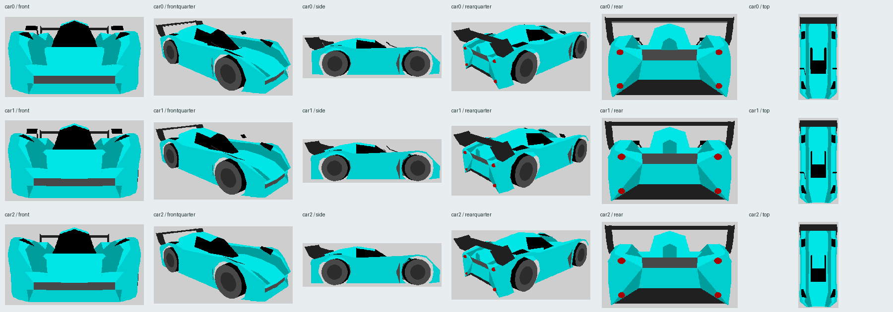

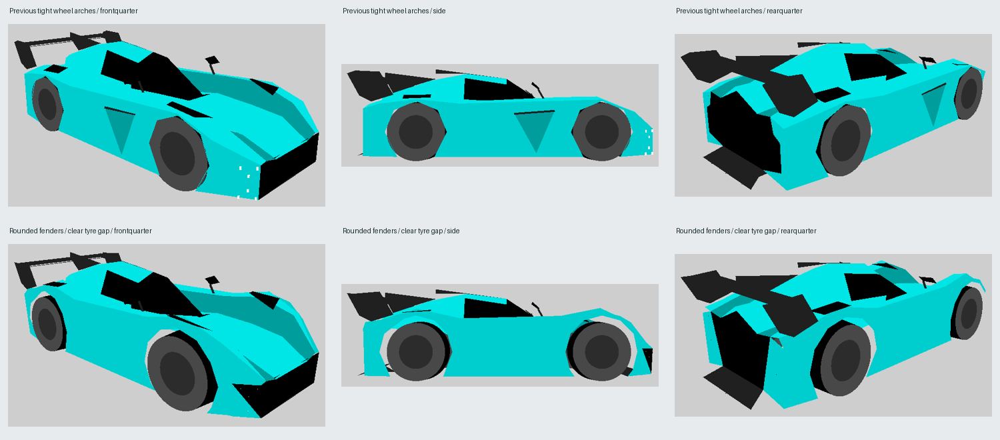

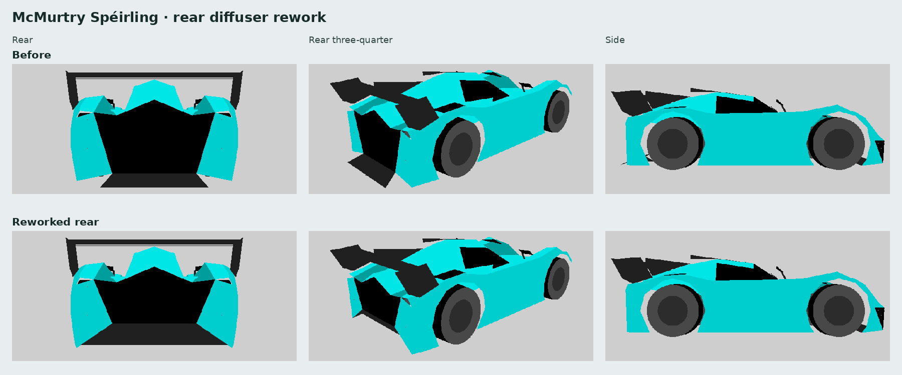

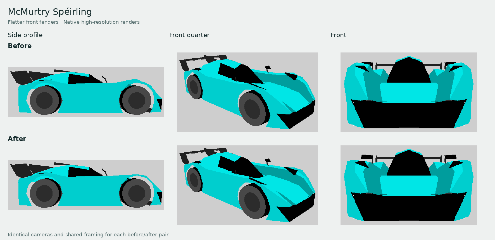

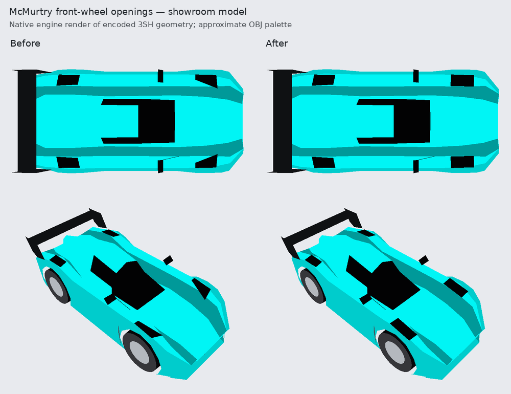

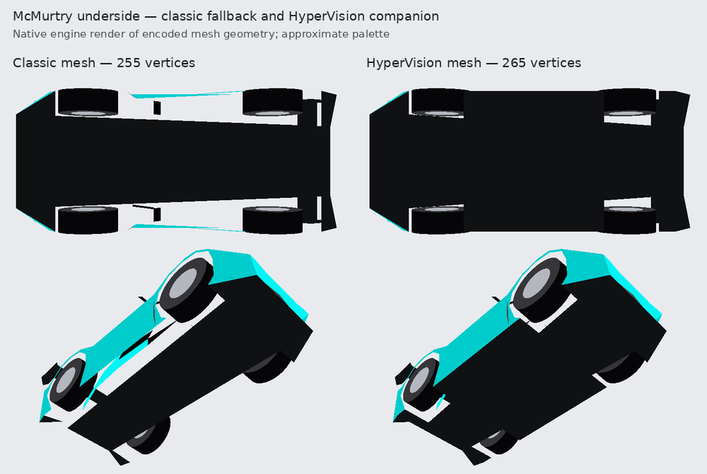

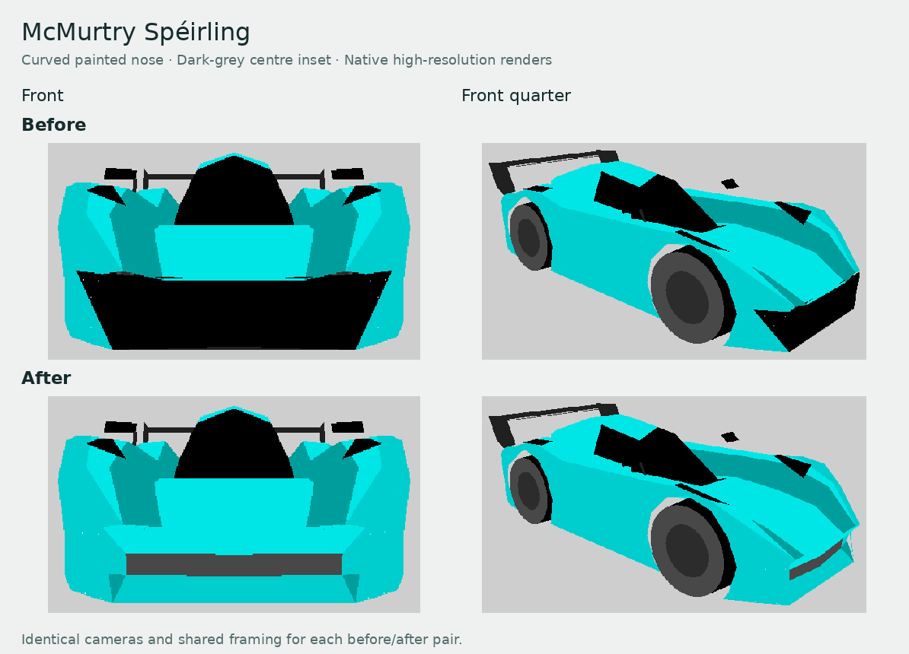

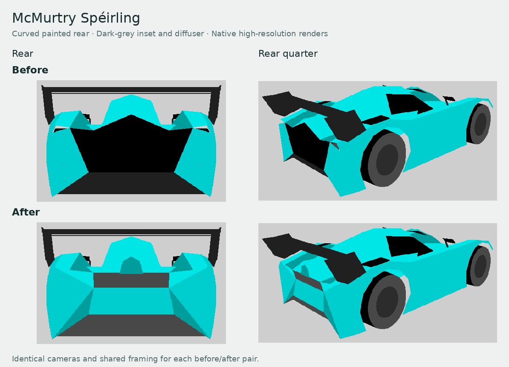

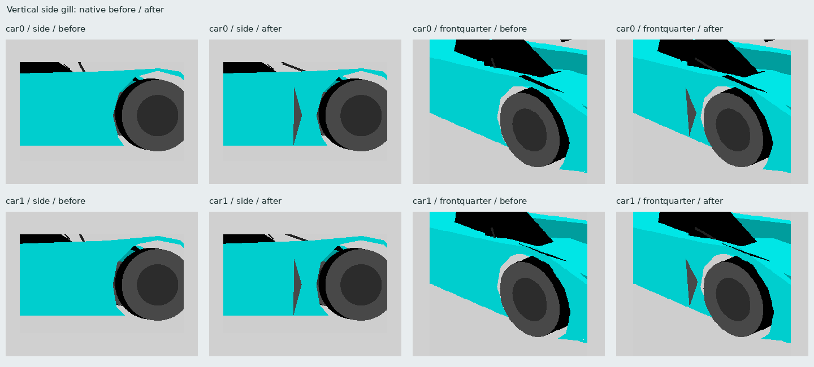

[2026 specifications in the car menu](cars/mcmurtry-menu.png)

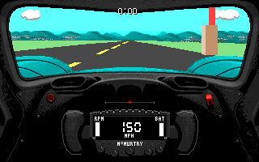

[Left steering](cars/mcmurtry-cockpit-left.png) ·
[Right steering](cars/mcmurtry-cockpit-right.png)

```sh
python3 tools/scripts/generate-mcmurtry-speirling.py --install stunts
python3 tools/scripts/generate-mcmurtry-speirling.py --check --install stunts
```

Select **McMurtry Speirling PURE** in the car menu. For another game-data
folder, copy `CARMCMU.RES`, `STMCMU.3SH`, `STDAMCMU.VSH` and `STDBMCMU.VSH`
from `assets/cars/` into its `cars/` subfolder. Restunts release packages include
the car automatically, and loose files in the game-data or executable folder
remain supported. Install the four files together. Add the optional
`STMCMU.H3D` companion beside them for HyperVision's detailed source-derived
exterior meshes. Classic rendering and original Stunts use the unchanged `.3SH` models.
`tools/scripts/cars/` retains
`MCMU.json` with reference URLs, dimensions and resource hashes, and
`READMCMU.TXT` with installation instructions. `MCMU.obj` and `MCMU.mtl`
provide a portable, editable 3D source export in metres, with Y up and tyre
bottoms at ground level; keep those two files together when importing. The OBJ
export represents the classic model. The companion is generated by
`mcmurtry_hypervision.py` from the retained compact showroom source and the
precomputed racing meshes in `cars/mcmurtry_racing_lods.json.gz`.

## Model source

The classic exterior was rebuilt from scratch as native low-polygon topology,
guided by the user-supplied `2026-mcmurtry-speirling.zip` GLB. The HyperVision
showroom imports and simplifies that GLB's exterior triangles. Its racing
meshes are low-polygon versions of the current H3D `car0` showroom model. The source is
[2026 McMurtry Spéirling](https://sketchfab.com/3d-models/2026-mcmurtry-speirling-24a39a15bde049acbb3ede571cee0c8b)
by [Dave Love SketchFab](https://sketchfab.com/Tyler_Dave), identified in its
embedded `asset.extras` metadata as
[CC BY 4.0](http://creativecommons.org/licenses/by/4.0/). The manifest records
that attribution and the supplied GLB's SHA-256 hash. The source contains
211,145 triangles, 110 meshes and 43 materials; its original high-polygon
GLB and textures are not included in this package. A compact transformed mesh
is retained for reproducible HyperVision generation without the original GLB.

### Classic model

Although the download is titled 2026, its hierarchy names
`exmods_mcmurtry_speirling22.fbx`, suggesting an earlier prototype. The supplied
high-resolution mesh establishes the exterior reference. The classic adaptation
replaces all exterior topology in the showroom and both racing detail levels.
The nose, canopy, side recesses, rear bodywork, roof, main rear wing and
wheel locations follow the source mesh. The thin centre fin above the canopy
and rear cowl is omitted for a clean roof silhouette. A subsequent wheel-area
refinement prioritizes rounded fenders and a visible tyre gap. The accepted
canopy surface and animated wheel controls remain unchanged. Mirror heads
retain their shape, with stems attached to existing fender-crown vertices to
reserve geometry for the side gills. The front fender crown follows the
source's shallow, nearly level profile toward the cockpit, with a small lift over the enlarged native arch instead of a tall
peak over the axle. The two openings above the front wheels are rectangular,
with parallel long sides and squared ends following the supplied overhead
photograph. Their four-corner outlines sit on the existing fender crowns in
the showroom and both racing detail levels.
The nose has curved body-colour bands above and below a narrow dark-grey
inset, rolled painted cheeks and a low splitter. The four white front lamp
markers are omitted. Four shared rows of five points form the front
curvature, with triangles joining the bands and side caps. The inset
uses native grey material 19 (RGB 72, 72, 72), keeping the remaining intake
visible without a broad black opening. The front cap and lower rim share
seams with the hood and undertray, including at racing precision.
Each side has a single tall, narrow, tapered gill behind the front wheel.
The user-supplied `detail.png` guides its vertical shape; the opening faces
rearward as requested. Its recessed dark-grey triangular wall is visible
from behind, while body-colour skin covers it from front-quarter views.
The centre pulls 1.5 game units inward to give the recess depth, while the
surrounding side panels share the existing wheel-arch edges. Three added
vertices per side form this detail without changing the tyre clearance.
The wing has two elements and large swept endplates. Native animated wheels
use integer controls, and seven paint schemes use native materials.
The rear fascia has painted shoulders that roll down from the complete
rear roof cross-section, and a painted lower bumper around a compact
dark-grey inset. Its lower edge sits one game unit inward, giving the
inset a shallow recess. It uses the same grey material 19 as the front
instead of a broad black panel. Four small circular red rings form an
upper and lower pair at each rear corner. Their nominal diameter is 10%
smaller, with dark concentric centres following the user-supplied
`mcmurtry-speirling-rear-view-900373069.jpg`. The dark inner diameter is
about 60% of the outer diameter. Nested native round primitives retain
brake material 45 on the rims, so they brighten while the centres stay
dark. Whole-unit racing coordinates can round the outer diameters back
to their previous size; the dark centres still reduce the filled red area.
Upper controls reuse existing fender-crown vertices. Merged coplanar sill
triangles and a hidden floor tapered to the existing diffuser entry free
the four extra controls needed for dark centres within the native vertex
limit. The canopy rear cap and main wing retain their geometry.
The rear undertray rises into the lower fascia,
with shared seams joining its centre ramp and side panels to the body. It
ends flush with the rear body instead of extending downward beneath the wing.
The exposed diffuser ramp and corner returns use the same darker grey
carbon material 39 as the underbody. The upper rear inset retains grey
material 19. The main floor stays inside the tyres and widens behind the
rear arches. This budget-limited floor remains in the classic fallback.
The earlier HyperVision companion filled strips between this floor and the
side sills; the detailed imported companion described below replaces it.

The manifest retains earlier exterior photo URLs as historical references.
The editable classic authoring source is
[`mcmurtry_model.py`](../tools/scripts/mcmurtry_model.py), with measured GLB
cross-sections, wheel centres and part bounds in
[`mcmurtry_source_profile.json`](../tools/scripts/mcmurtry_source_profile.json).
The reference GLB is not required for deterministic regeneration.
`MCMU.obj` and `MCMU.mtl`
export the adapted low-polygon geometry, with 16-segment annular rear
lenses and dark centres, avoiding overlapping faces. See
[`THIRD-PARTY-NOTICES.txt`](../THIRD-PARTY-NOTICES.txt) for its attribution
and modification notice.

`car0` is the showroom shape; `car1` and `car2` are the racing detail levels.
Four new `exp` shapes use panels from the rebuilt fender, door, glass and
wing as crash debris. Classic shapes use native Stunts primitives and remain
within its 255-vertex and 255-primitive limits.

| Shape | Vertices | Primitives |
| --- | ---: | ---: |
| `car0` showroom | 255 | 247 |
| `car1` racing | 255 | 247 |
| `car2` distant racing | 247 | 243 |

### Detailed HyperVision companion

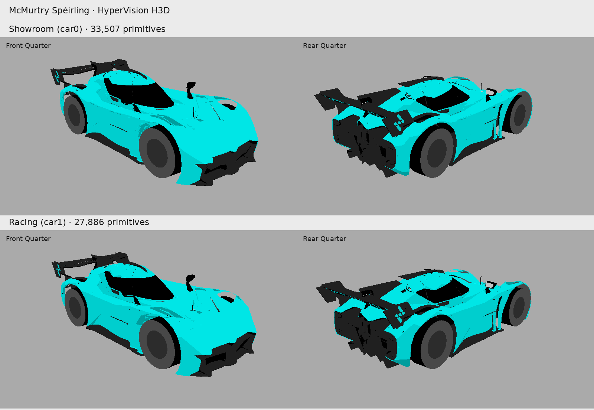

The optional `STMCMU.H3D` retains the imported source exterior for its showroom
mesh. Source node transforms, uniform scaling and precomputed quadric error
reduction place it in the car's coordinate system. The `car0` showroom payload
remains byte-identical after rebuilding the racing detail levels.

All three HyperVision models display at **125/168 of their authored size**
(74.405%, a 25.595% reduction), with exactly the same factor on X, Y and Z.
This includes the body, animated wheels and bounds. The accepted mesh payloads,
topology, materials, symmetry and vertex counts are byte-identical. The scale
is stored in the H3D version 3 container header and applied after decoding,
avoiding distortion from rounding the integer wheel controls. Body coordinates
are scaled once when loaded; only wheel controls need refreshing during animation.

The height reference is the stock Audi in `STAUDI.P3S`, whose showroom is 26
game units tall after removing its 20× showroom scale. The unscaled McMurtry
showroom is 27.3 units tall. Wikipedia was checked on 2026-11-09:

| Dimension | [Audi Sport Quattro S1 E2](https://en.wikipedia.org/wiki/Audi_Quattro#Sport_Quattro_S1_E2) | [McMurtry Spéirling](https://en.wikipedia.org/wiki/McMurtry_Sp%C3%A9irling) |
| --- | ---: | ---: |
| Length | 4,240 mm | 3,815 mm |
| Width | 1,860 mm | 1,795 mm |
| Height | 1,344 mm | 1,050 mm |
| Wheelbase | 2,204 mm | 2,200 mm |

The uniform scale is `(26 × 1050 / 1344) / 27.3 = 125/168`, giving a showroom
height of 20.3125 units, or 78.125% of the Audi's height. Stock model proportions
prevent matching both real height and wheelbase ratios with a single scale;
height is the selected reference. The displayed McMurtry wheelbase is 37.2024
units, versus the Audi's 46. No dimension is stretched independently.

Showroom tyres stay on Y=0; racing tyres stay on Y=-6. Bounds, shadows and
rendered wheel clearances follow the scaled geometry. This adjustment applies
to H3D presentation; classic fallback assets, physics contact points and
collision sizes retain their existing units. The factory specification section
below retains the manufacturer's 1,056 mm production height; Wikipedia's
1,050 mm is the requested visual comparison reference.

Both racing meshes are reduced directly from that current H3D `car0` geometry.
The conversion removes its showroom scale and vertical offset to restore
racing coordinates, then simplifies the body triangles. The total vertex
budgets are **1,000–1,200 for `car1`** and **400–500 for `car2`**, including the
eight bounding vertices and 24 animated wheel controls. These limits bound
the vertex transformation work performed by the CPU renderer. The generator
rejects racing meshes outside those ranges.

All models retain the native animated wheels, steering, suspension and classic
physics controls. The racing meshes retain the source palette materials and
all seven paint schemes. Fine source features are simplified according to the
available geometry budget. Original textures are not reproduced. The imported
showroom input contains 119,399 exterior triangles from 33 source mesh groups,
with hidden cockpit geometry and alpha decals omitted. Each shape stays within
HyperVision's limit of 65,535 vertices and 65,535 primitives.

The retained transformed showroom input is
[`mcmurtry_hypervision_source.json.gz`](../tools/scripts/cars/mcmurtry_hypervision_source.json.gz).
The two reduced racing meshes are retained separately in
[`mcmurtry_racing_lods.json.gz`](../tools/scripts/cars/mcmurtry_racing_lods.json.gz).
[`mcmurtry_hypervision.py`](../tools/scripts/mcmurtry_hypervision.py) reads both
compact files using Python's standard library. The racing cache records the
SHA-256 of its exact source `car0` payload. If the showroom model changes,
normal generation rejects the stale cache until the racing meshes are rebuilt
from the updated `car0`. The older imported racing detail levels inside the
showroom source file are retained for provenance and are not used.

Normal car generation needs neither the original GLB nor external modeling
tools. The source hash and attribution remain recorded in the car manifest.
Rebuilding the compact showroom input requires Python 3.12 or later for the
pinned optional import dependencies. It performs quadric error reduction
offline. Install the packages in the Python environment used for reimport,
then pass the same original ZIP:

```sh
python3 -m pip install -r tools/scripts/requirements-mcmurtry-hypervision.txt
python3 tools/scripts/mcmurtry_hypervision.py --source /path/2026-mcmurtry-speirling.zip
```

The requirements pin `fast-simplification==0.2.0` and `numpy==2.5.4`; ordinary
car generation does not import either package. Reimporting the showroom input
also requires rebuilding the racing cache if its encoded `car0` changes.

The `--source` argument also accepts the extracted GLB. The importer verifies
its SHA-256 against the attributed source before applying scene transforms.
Running the module without arguments reports the current companion mesh counts.

To rebuild the racing cache directly from the current installed H3D `car0`,
install the separate offline LOD dependencies, then regenerate the car assets:

```sh
python3 -m pip install -r tools/scripts/requirements-mcmurtry-lods.txt
python3 tools/scripts/generate-mcmurtry-lods.py
python3 tools/scripts/generate-mcmurtry-speirling.py
python3 tools/scripts/generate-mcmurtry-speirling.py --check
```

The LOD authoring pass uses material-constrained quadric edge collapse for
`car2` and the rear of `car1`. It retains palette seams and the rear wing,
removing small disconnected fittings. Thin wing blades use closed convex
envelopes of their source vertices. Both levels start from `car0`.

The near mesh rebuilds the front as connected panels sampled from the source
hood, canopy and nose. Shared edges join the hood, bounded wheel-vent recesses,
wheel wells and continuous bumper. The positive half of the complete `car1`
body is reflected across welded centreline vertices, including its triangles
and all seven paint tables. Source-based closed mirror pods retain the front
silhouette. The rear canopy sill shares its painted boundary with the body;
the shoulder closes at the source channel contour. Source-sampled fender lips
and bumper corners keep internal dark surfaces behind the exterior panels.
Wheel-arch triangles are checked after fixed-point encoding.

Regression checks cover exact encoded symmetry, closed front panel edges,
source hood and bumper coverage, and clearance around the native tyres.
The saved cache records the source payload hash and authoring settings;
NumPy and SciPy are needed only for this offline pass. Use
`generate-mcmurtry-lods.py --lod car1` to rebuild only the near mesh while
retaining the cached distant mesh.

| HyperVision shape | Vertices | Primitives | Body coordinate step |
| --- | ---: | ---: | ---: |
| `car0` showroom | 21,648 | 33,507 | 2.2 mm |
| `car1` racing | 1,199 | 2,143 | 2.75 mm |
| `car2` distant racing | 499 | 810 | 2.75 mm |

Vertex counts include the eight bounds and 24 animated wheel controls;
primitive counts include four native wheels. Body positions retain fractional
precision during simplification, then round to the stored coordinate step.
H3D uses native palette surfaces without interpolated shading normals.

The companion uses H3D version 3 with signed 16-bit body-coordinate storage
and wide vertex indices above 255 vertices. Showroom bodies use whole model
coordinates at the stock 20× scale, approximately 2.2 mm per stored step.
Racing bodies use four fraction bits, giving 1/16-unit coordinates or about
2.75 mm per stored step. The first eight bounds and 24 animated wheel controls
retain native whole units in the payload; the presentation scale applies after
decoding. The precision figures above describe authored coordinates.
See the [H3D format](hypervision-meshes.md#container-format-versions-2-and-3).

Mesh reduction and coordinate quantization can still merge or remove small
source features. H3D uses native palette surfaces; source UVs, textures and
smooth-shading normals are omitted. HyperVision selects the detailed meshes
when available; turning it off immediately restores the unchanged classic
shapes. The loader accepts H3D versions 2 and 3; invalid or unsupported companions
use the classic models. Ports without HyperVision ignore it.

The first eight car vertices are bounds; the following 24 are the classic
model's animated wheel controls.

## Cockpit

The cockpit is original indexed-colour artwork. Its dashboard layout follows
the supplied
`6.-McMurtry-Speirling-studio-interior-1-1024x683-2898273447.jpg` studio photo:
a slim fascia in a dark carbon surround, an empty upright display mount on
the left and two small recessed dark ducts on the right. This replaces the
earlier teal pods and four large silver vents. The requested material override
replaces the photo's tan trim with light grey carbon. Its diagonal weave slopes
in the opposite direction from the rest of the dashboard.

The retained wheel follows the supplied `1000005914.jpg`, `1000005913.jpg`
and `1000005912.jpg` photographs and the earlier
[wheel reference](https://www.topgear.com/car-reviews/speirling/first-drive).
An LCD and unlit lamp row sit within a continuous shaped rim:
textured side grips join contrasting carbon top and bottom bridges. Every rim
section rotates about the same hub in each steering view, together with the
complete display panel, live digital speedometer and motor needle. The five fluted
knobs match and have blank interiors. The record-holder inscription is removed,
and the live instrument needle is red. Stitched padding, carbon trim, seams,
fasteners and release hardware add restrained detail on both sides. Speed and
motor instruments update live in all three steering positions.

Material shading, irregular carbon weave, suede and grip grain give the
cockpit the finish of a palette-reduced photograph. The grain is deterministic
and stays attached to the wheel as it turns, together
with the live LCD. Brighter wheel carbon and trim, grey grip-edge
highlights and a darker column recess keep its outline distinct. A native
steering dot slides along a horizontal strip above the shaped wheel, as on the
Pontiac Firebird, showing the steering angle between wheel poses.

Optional `imt1` and `imt3` bitmap headers provide inverse Q14 transforms for
left and right steering. Their anchor X/Y and position X/Y fields hold the
matrix coefficients in row order; the `ins2` anchor is the source-local wheel
pivot. Restunts composes the full display, live speed digits and motor needle
in its scratch bitmap, then samples that bitmap through the selected transform
inside the wheel sprite's redraw rectangle. The wheel background is restored
before gauge updates, clearing the previous tilted digits. Dashboards without
these descriptors keep the existing instrument path. Original Stunts ignores
the extra descriptors and keeps the McMurtry display upright.

The upper carbon cowl follows a gentle curve around the wheel, with a shaded
lip. Native `dast`/`dasm` artwork and masks draw this crown and raised front
fenders with dark top openings. The road remains live around the silhouettes.
These bitmap fenders retain their turquoise finish in every exterior paint
scheme, as with fixed-colour bodywork in stock Stunts dashboards.

The enclosed canopy follows the supplied driver's-eye
`5-Speirling-Interior-3083165339.webp` photograph, with the open-canopy
`mcmurtry-speirling.7-614860014.jpg` and `OIP-943499069.jpg` views supplying
the curved roof ring and side structure. A broad bowed dark-carbon header
and rounded corners frame one wide forward windscreen. One pair of pillars
stays at the far screen edges; the high-FOV photograph's side windows are
omitted as requested. The surround uses the dashboard's darker carbon in
every paint scheme. A native opaque `roof` strip covers the first 24 rows;
expanded `dast`/`dasm` masks preserve live scenery through the windscreen
below it. Grouped horizontal texture samples retain the carbon weave while
keeping native RLE memory below the existing DIA3 limit. The dashboard and
live wheel instruments keep their existing positions.

## Classic exterior rendering

The classic model's fender crowns use four points across each side to round
the shoulders. Side arch openings follow a ten-unit circle in 30-degree steps around the
eight-unit tyres. The larger openings preserve a visible gap after native
integer rounding, including the projected front-wheel steering envelope.
Four source-derived wheel-crown openings use bounded dark quadrilateral
surfaces within the fenders. Their native attachment to each animated wheel
preserves the drawing order in angled views.

The native painter sorts a whole wheel at its rim centre and ordinary
polygons at their average vertex depth. A physically correct fender can
therefore paint behind its wheel in an angled view. In the classic mesh, each
wheel is followed by its covering fender faces with primitive flag `0x02`, which
attaches them to the wheel's drawing order. The wheel paints first, then
its cover. Outward face culling and open side arches are retained in the
classic mesh.

## Real specifications and scale

Specifications were checked on 21 October 2026 against
[Wikipedia](https://en.wikipedia.org/wiki/McMurtry_Sp%C3%A9irling), the
[current factory specification](https://mcmurtry.com/speirling-pure/), the
[July production announcement](https://mcmurtry.com/mcmurtry-speirling-production-form/)
and the [September debut report](https://mcmurtry.com/speirling-usa-debut/).
The production car publicly debuted at Monterey Car Week in August 2026;
first customer deliveries were announced for later in 2026.

The production specification is 1,000 bhp (745 kW), approximately 1,350 kg
depending on options, a 100 kWh battery and a 190 mph top speed. Twin motors
drive the rear wheels through a single-speed transmission and E-differential.
The claimed 0–60 mph time is **1.55 seconds with one-foot rollout**.
Michelin Pilot Sport GT S8M slicks are 30/68-18 front and 31/71-18 rear.
The factory lists 2,000 kg of downforce from standstill and 3 g cornering and
braking capability.

Wikipedia still mixes its production dimensions and battery capacity with
older 900 kg / sub-1,000 kg weight figures and a rounded 1,050 mm height.
The factory's current approximately 1,350 kg and 1,056 mm figures take
precedence. The canonical data and source reconciliation live in
[`mcmurtry_physics.py`](../tools/scripts/mcmurtry_physics.py).

A uniform **44 mm per racing-model unit** follows the stock Corvette's
4,506 mm / 103 units and the NSX's 4,405 mm / 100 units. Stock cars have
stylized proportions, so no new car can match every stock car exactly.

The downloaded mesh is uniformly scaled to the nominal 3,815 mm car length
at that scale. Its width and height preserve the source aspect ratio; they
are not adjusted to the production specification. The unrounded visual
envelope is approximately 86.7 × 38.8 × 27.3 game units (length × width ×
height). The classic rounded wheel areas deliberately adapt that reference. The
showroom uses the stock 20× scale, and both racing detail levels share the
same overall size and wheel controls.

The native car origin is centered between its axles. At 44 mm per game unit,
the specified 2,200 mm wheelbase is exactly 50 units: visual front centres
are `(±16, 2, 25)` and rear centres are `(±16, 2, -25)`, with eight-unit radii
and three-unit half-widths. Tyre bottoms meet the engine's `y = -6` contact
plane. The ignored SIMD wheel Y fields are zero, while its X/Z coordinates
match the visual wheel controls exactly.

The classic source body shifts by 1.5 units along Z before native rounding.
Wheel arches follow the adapted axles, OBJ tyres use the same centered coordinates,
and collision bounds enclose the shifted body. The generator rejects
uncentered physical wheels, nonzero physical Y fields, mismatched visual
controls, incorrect tyre contact, and collision bounds that miss the model.
This follows the original engine's car format without changing its physics.
Replays recorded with the earlier McMurtry resources can follow a different
trajectory because the corrected car no longer adds unintended movement.
See [the stock dimensional references](tesla-sizing.md#stock-reference-measurements)
for the Corvette and NSX sources.

## Driving and adhesion

The native drivetrain uses a single fixed ratio, an electric torque plateau
and falling high-speed torque. SIMD mass, torque and grip values are game
tuning units, rather than SI measurements. The grip value is 1,200.
Acceleration is calibrated to
the production car's 1.55-second claim with one-foot rollout. The manifest
records standing-start and rollout-adjusted game times separately.

The grounded, level-road drivetrain update was checked against native
`statecar.c` with the generated SIMD:

| Physics rate | Standing 0–60 mph | 0–60 with 1 ft rollout | 0–100 mph | Peak speed |
| --- | ---: | ---: | ---: | ---: |
| 20 Hz | 1.75 s | 1.55 s | 3.10 s | 190.22 mph |
| 10 Hz | 1.80 s | 1.60 s | 3.10 s | 190.44 mph |

The engine's redline braking produces a small speed oscillation around the
limit. These figures isolate the drivetrain with all tyres grounded; track
geometry, steering and collisions can change a full driving run.

`fand = 01` enables adhesion. `adhs = 01 0C 00 00 20 0F` explicitly selects
12 world units, a 60-degree alignment limit and paved/dirt/ice/grass surfaces.
Updated Restunts reads those settings independently for player and opponent.
The system attaches tyre contacts to supported driving surfaces, including
vertical and inverted ones, and releases when contact is lost. It is the
engine's approximation of fan downforce; it does not simulate aerodynamic
suction or permit adhesion to water. Original Stunts ignores both resources.
See [the adhesion format](car-adhesion.md). Use identical car resources for
recording and replay playback.

## Validation

The generator validates DSI directories, the 776-byte SIMD, car text,
seven model resources, polygon indices and normals, animated wheel slots,
bounding boxes, visual/physical wheel agreement, contact height and uniform
source scaling. Classic visible height follows the canopy ridge after removing
the centre fin; the original source bounds remain recorded separately.
For the classic meshes it samples the encoded upper tyre envelope against the
body surface and measures the actual side-facing triangles around each outer
tyre face. This catches arch chords or filled openings that intersect a tyre
after integer rounding, even when the roof clears it. Front-wheel checks
include a conservative projected envelope for the full steering range.
Every encoded outer arch must leave at least **one game unit (44 mm)** of
gap. Current minimum clearances, in game units, are:

| Shape | Front arches | Rear arches | Upper cover |
| --- | ---: | ---: | ---: |
| `car0` showroom | 1.108 | 1.317 | 1.688 |
| `car1` / `car2` racing | 1.262 | 1.191 | 1.738 |

The lower front crown retains the same side-arch gaps and more than one
game unit of upper tyre clearance after native integer rounding.
The arch minima apply to both wheels on each axle. Only triangles attached
to the matching wheel count as upper cover, so a change that loses the
required native drawing order also fails generation.
It validates cockpit bitmaps, the opaque roof strip, aligned canopy masks
and needle colour.
Generation requires strictly less dashboard memory than DIA3, both after
extraction and after native preparation, including instrument/gearbox scratch.
`--check` compares generated bytes with the package and optional installed
game files. Run `python3 tools/scripts/test-mcmurtry-wheel-clearance.py` for
focused regressions covering crossed arch chords, filled openings, inner
channel faces, steering envelopes and both coordinate scales. The generator
also validates the detailed companion directory, shape limits, palette
materials, wide indices and matching animated wheel controls. Both racing
companions are checked separately against the encoded native tyre
clearance envelope. The classic wheel-cover assertions describe the unchanged
low-polygon fallback and its native drawing order.

The classic 320×200 native loader and allocator give these dashboard sizes:

| Stage | MCMU | DIA3 |
| --- | ---: | ---: |
| Extracted STDA + STDB | 143,523 bytes | 148,036 bytes |
| Prepared STDA + STDB in the arena | 59,472 bytes | 66,176 bytes |
| Shared instrument/gearbox scratch bitmap | 3,792 bytes | 14,128 bytes |
| Resident arena total including scratch | **63,264 bytes** | **80,304 bytes** |

The prepared and scratch sizes include the native 16-byte allocation rounding.
Both dashboards share their instrument and gearbox scratch bitmap: MCMU uses
99×38 pixels, while DIA3 uses 188×75. Sprite definitions and row tables occupy
the common preallocated window table. MCMU therefore uses about 3% less
extracted resource memory and 21% less resident dashboard arena memory.
The same sizes and strict limits are recorded in `MCMU.json` and `READMCMU.TXT`.

The retained exterior contact sheet renders the classic encoded showroom and
both racing models through the native renderer from six views. The earlier
underfloor comparison records the previous underside-only HyperVision mesh,
rather than the detailed imported companion. The wheel comparison uses
matching angles for the earlier boxier wheel areas and the refined rounded
fenders and arches. The rear comparison shows the removed hanging panel and
its replacement with a connected rising undertray from matching angles.
The front-profile comparison records the earlier lower, flatter crown
correction from matching side, front-quarter and front cameras. The nose
comparison shows the broad black opening replaced with curved painted panels
and a narrow dark-grey inset. The tail comparison shows the broad black
rear fascia replaced with rolled painted shoulders, a lower painted bumper
and a compact recessed grey inset. It retains the lighter grey diffuser
surfaces from that earlier revision. The historical side-detail comparison
shows the earlier plain side panels and the original forward-facing upright
gills from matching side and front-quarter cameras for the showroom and
racing models. The current exterior and paint previews include the revised
ends and rear-facing side gills, with the lower rear matching the darker grey
underbody, the white front lamp markers removed and the earlier solid round
rear lamps in vertical pairs. The current model uses smaller red rings with
dark centres. The other comparison sheets retain their earlier
stages, including any front markers or the earlier two rear point markers.
These deterministic captures make the visible tyre gap, source-shaped
silhouette, painted nose and rear curvature, upright side gills, clean canopy,
two-element wing, swept endplates, round rear lamps and dark crown slots
reviewable.

Existing cockpit and menu captures document the digital instruments,
steering positions and nine-row car description. The retained driving
validation uses a temporary `MCMU` replay, including a two-car setup that
checks adhesion for both slots. These checks use isolated game data and
leave saved games intact.
