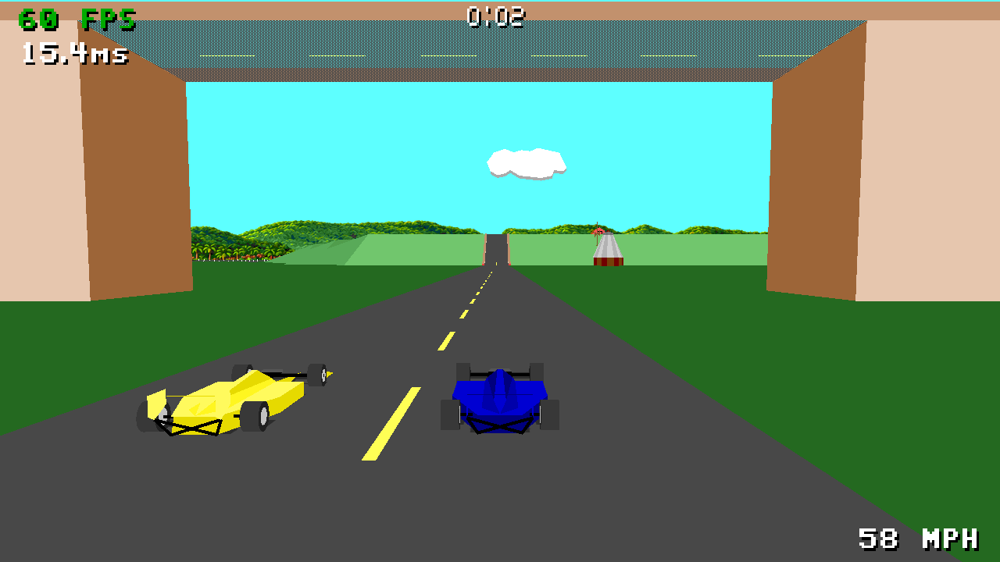

# Chocolate Stunts

Website: https://commonloon102.github.io/restunts-bb11/

Vanilla, Chocolate and SDL port for Stunts 1.1 (Brøderbund).

For the vanilla source without any fixes or added features,
switch to the `vanilla-stunts` branch.  
It is 16-bit DOS only.

This project is based on Restunts: https://wiki.stunts.hu/wiki/Restunts

Initially forked from this repository: https://github.com/4d-stunts/restunts

## Runnable packages
Go to the website and find them at the downloads section:  
https://commonloon102.github.io/restunts-bb11/#downloads

You will need to provide the **game files** yourself, they are **not included** in the downloads.

All packages were created by GitHub CI and released as an immutable release directly from the pipeline, so it is guaranteed that the binaries are built directly from the source available on GitHub.

## Features
- Native builds for
  - Windows
  - Linux
  - MacOS
  - Android
  - DOS
  - Browser
  - FreeBSD
  - NetBSD
  - OpenBSD  
  - Haiku  
  - Amiga
  - TempleOS
- 100% compatible with Stunts 1.1 (Brøderbund)
  - Custom cars
  - Tracks
  - Replays
- Enhanced renderer (optional)
  - Unlimited line of sight
  - Higher resolution (4x)
  - Higher framerate (60 FPS)
  - Widescreen support (3:2, 16:10, 16:9, 20:9)
  - Support for more detailed car models
  - Up-scaled horizons, backgrounds, opponent profiles
- Sound modes
  - MT-32 (provide your ROMs)
  - Ad Lib
  - Tandy
  - PC Speaker
- Video modes
  - VGA, EGA, CGA, Tandy
- Quality-of-Life features
  - Hold Q to rewind
  - Up to 120 cars at once in the showroom
  - Load custom cars from ZIP files
  - Ask confirmation for re-start driving
  - Startup window (for settings)
  - Replaceable custom music (.ogg)
- Controller support
  - Customize controller bindings
- Touch layout for mobile
  - Customize the layout for your hand
- Extended map editor
  - 90 x 90 tiles of maximum track size
  - New track elements (barrel roll, checkpoints, tulip fields, etc.)
  - 4 levels of terrain  
  - 3D preview
  - Custom horizons support
- New opponent
  - A new AI generated by AI
- Race against a ghost
  - Open a replay and race against it
- Multi-replay
  - Play back multiple replays from the same track in a shared timeline
- Disable original bugs (optional)
  - Turn off power gear
  - Fix collision bugs
  - Fix left-corner bias
  - Fix dual-way switching
- And much more...

## AI usage
It's not a secret, AI was used for the following:
- Writing code
- Reviewing code
- Manual testing
- Writing documentation
- Writing automatic tests
- Writing the CI pipeline
- Upscaling some pictures and backgrounds
- Generating the two new cars (Tesla Roadster Rocket and McMurtry Spéirling PURE)

### AI models used:
- GPT Sol: 5.6, 6, 6.1, 6.2 @ Ultra
- GPT Astra: 6, 6.2 @ Ultra
- Claude Opus 5 @ Ultracode
- Claude Fable 5 @ Ultracode

## How quality is ensured?
I've collected 7000 replays from the past 25 years and ran them through with the original game
and with the newly built one. Every frame of the ~190 hours of gameplay is producing the same pixel output.
This check is running for every PR and release pipelines also.

I've also done a huge amount of manual testing myself,
to test everything else what was not having automated tests.

## How to use the documentation?

The documentation is 100% AI generated.
It's not slop, no hallucinations, and it is up to date.
However, who likes to read documentation? The answer is: AI.
So, if you are a human, you won't read it anyway. Even if you
want to know something about the game, you will give the GitHub
link to an AI agent and ask your questions and it will find
the answers in the .md files and in the source code.

Surprise: the docs are in the docs folder.
Some starting points:

- [Documentation for users](docs/users.md)
- [Documentation for developers](docs/devs.md)
